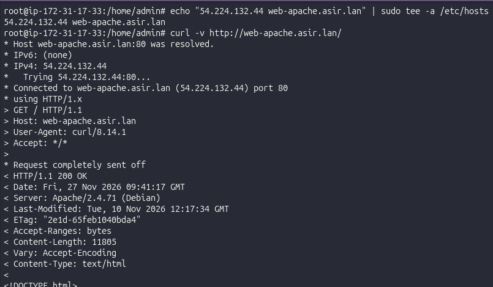
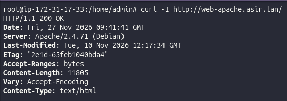
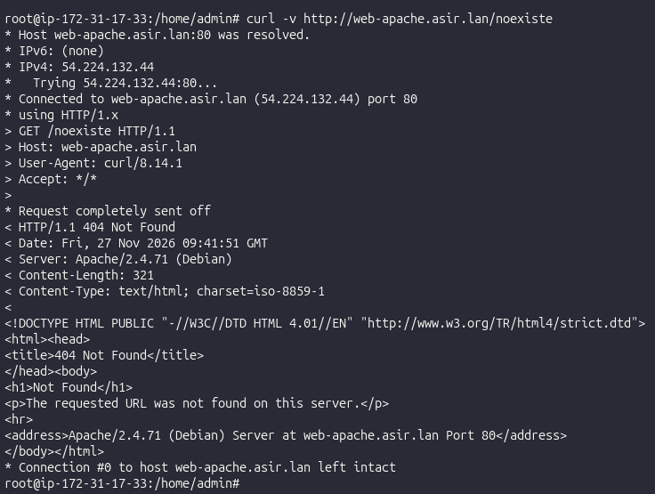
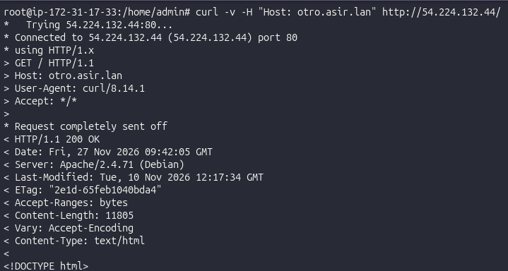
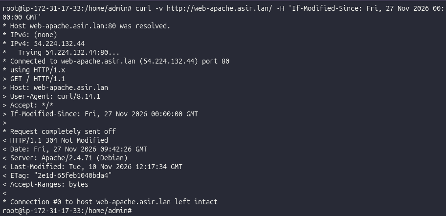
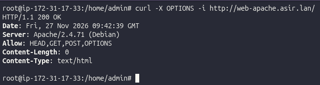

# Servicios de Red e Internet — RA3: Tareas de servidores web

Documentación completa de las tareas de administración de servidores web (**T1–T7**) realizadas sobre instancias **Debian 13 (Trixie)** en **Amazon Web Services (AWS)**, adaptando el escenario de prácticas (`web-apache`, `web-nginx`, `lb`, `ca`, `cliente`) al entorno cloud con Apache, Nginx, HAProxy, Varnish, ApacheBench (`ab`), Gnuplot y GoAccess.

---

## Índice de Tareas (RA3)
- [T1. Anatomía de HTTP (criterio a)](#t1-anatomía-de-http-criterio-a)
- [T2. Apache y Nginx: instalación, módulos, URLs y sitios virtuales (criterios b, c, d)](#t2-apache-y-nginx-instalación-módulos-urls-y-sitios-virtuales-criterios-b-c-d) *(Pendiente)*
- [T3. Autenticación y control de acceso (criterio e)](#t3-autenticación-y-control-de-acceso-criterio-e) *(Pendiente)*
- [T4. CA propia y HTTPS endurecido (criterios f, g)](#t4-ca-propia-y-https-endurecido-criterios-f-g) *(Pendiente)*
- [T5. Proxy inverso, balanceo y pruebas de rendimiento (criterios g, h)](#t5-proxy-inverso-balanceo-y-pruebas-de-rendimiento-criterios-g-h) *(En progreso — HAProxy + Varnish + `ab` + Gnuplot)*
- [T6. Logs: estadísticas e incidencias (criterio i)](#t6-logs-estadísticas-e-incidencias-criterio-i) *(En progreso — `mod_remoteip` + GoAccess)*
- [T7. Documento de servicio (criterio j)](#t7-documento-de-servicio-criterio-j) *(Pendiente)*

---

## T1. Anatomía de HTTP (criterio a)

### 1. Pruebas de protocolo con `curl`

#### Prueba 1: Petición `GET` completa
```bash
curl -v http://web-apache.asir.lan/
```
```text
*   Trying 54.224.132.44:80...
* Connected to web-apache.asir.lan (54.224.132.44) port 80
> GET / HTTP/1.1
> Host: web-apache.asir.lan
> User-Agent: curl/8.14.1
> Accept: */*
< HTTP/1.1 200 OK
< Date: Fri, 27 Nov 2026 09:41:17 GMT
< Server: Apache/2.4.71 (Debian)
< Last-Modified: Tue, 10 Nov 2026 12:17:34 GMT
< ETag: "2e1d-65feb1040bda4"
< Accept-Ranges: bytes
< Content-Length: 11805
< Vary: Accept-Encoding
< Content-Type: text/html
```
**Interpretación:** El cliente establece una conexión TCP al puerto 80 y envía una petición `GET /`, ante la cual Apache responde `200 OK` devolviendo las cabeceras y los 11.805 bytes del `index.html`.



#### Prueba 2: Petición `HEAD` (solo cabeceras)
```bash
curl -I http://web-apache.asir.lan/
```
```text
HTTP/1.1 200 OK
Date: Fri, 27 Nov 2026 09:57:38 GMT
Server: Apache/2.4.71 (Debian)
Last-Modified: Tue, 10 Nov 2026 12:17:34 GMT
ETag: "2e1d-65feb1040bda4"
Accept-Ranges: bytes
Content-Length: 11805
Vary: Accept-Encoding
Content-Type: text/html
```
**Interpretación:** Con el método `HEAD` (`-I`), el servidor devuelve únicamente las cabeceras de respuesta sin transferir el cuerpo HTML, permitiendo comprobar metadatos como tamaño o fecha de modificación ahorrando ancho de banda.



#### Prueba 3: Recurso inexistente (`404 Not Found`)
```bash
curl -v http://web-apache.asir.lan/noexiste
```
```text
> GET /noexiste HTTP/1.1
> Host: web-apache.asir.lan
< HTTP/1.1 404 Not Found
< Date: Fri, 27 Nov 2026 09:57:39 GMT
< Server: Apache/2.4.71 (Debian)
< Content-Length: 321
< Content-Type: text/html; charset=iso-8859-1
```
**Interpretación:** Al solicitar una ruta que no existe en el `DocumentRoot`, Apache responde con el código de error de cliente `404 Not Found` y una pequeña página HTML informativa de 321 bytes.



#### Prueba 4: Petición por IP forzando cabecera `Host`
```bash
curl -v -H "Host: otro.asir.lan" http://54.224.132.44/
```
```text
> GET / HTTP/1.1
> Host: otro.asir.lan
< HTTP/1.1 200 OK
< Server: Apache/2.4.71 (Debian)
< Content-Length: 11805
< Content-Type: text/html
```
**Interpretación:** Aunque la petición se hace directamente a la IP con un nombre de dominio distinto en la cabecera `Host`, Apache la atiende con `200 OK` sirviendo el *VirtualHost* por defecto al no tener otro sitio configurado para `otro.asir.lan`.



#### Prueba 5: Petición condicional con `If-Modified-Since` (`304 Not Modified`)
```bash
curl -v http://web-apache.asir.lan/ -H 'If-Modified-Since: Fri, 27 Nov 2026 00:00:00 GMT'
```
```text
> GET / HTTP/1.1
> Host: web-apache.asir.lan
> If-Modified-Since: Fri, 27 Nov 2026 00:00:00 GMT
< HTTP/1.1 304 Not Modified
< Date: Fri, 27 Nov 2026 09:57:39 GMT
< Server: Apache/2.4.71 (Debian)
< Last-Modified: Tue, 10 Nov 2026 12:17:34 GMT
< ETag: "2e1d-65feb1040bda4"
< Accept-Ranges: bytes
```
**Interpretación:** Como la fecha de modificación del recurso (`10 Nov 2026`) es anterior a la indicada en `If-Modified-Since`, el servidor responde `304 Not Modified` sin reenviar el cuerpo del fichero para que el cliente reutilice su copia en caché.



#### Prueba 6: Métodos HTTP permitidos (`OPTIONS`)
```bash
curl -X OPTIONS -i http://web-apache.asir.lan/
```
```text
HTTP/1.1 200 OK
Date: Fri, 27 Nov 2026 09:57:39 GMT
Server: Apache/2.4.71 (Debian)
Allow: HEAD,GET,POST,OPTIONS
Content-Length: 0
Content-Type: text/html
```
**Interpretación:** El método `OPTIONS` consulta al servidor qué verbos HTTP están habilitados sobre esa URL, devolviendo la cabecera `Allow: HEAD,GET,POST,OPTIONS` con cuerpo vacío.



---

### 2. Captura con Wireshark / `tcpdump`
*(Pendiente de añadir captura de Wireshark / `tcpdump` mostrando handshake TCP, petición, respuesta y keep-alive).*

---

### 3. Respuestas razonadas

1. **¿Qué cabecera permite que el cuarto `curl` llegue al sitio por defecto y por qué es la base del hosting virtual?**  
   La cabecera **`Host`** (obligatoria desde HTTP/1.1). Permite que un mismo servidor con una única dirección IP publique múltiples sitios web distintos: el servidor lee el valor de `Host` para decidir qué *VirtualHost* (o `server_name` en Nginx) debe responder, y si ninguno coincide, entrega el sitio por defecto.

2. **¿Qué código obtienes con `If-Modified-Since` y qué ahorra?**  
   Se obtiene **`304 Not Modified`** (cuando el recurso no ha cambiado desde esa fecha). Ahorra **ancho de banda y tiempo de transferencia** porque el servidor envía solo cabeceras sin el cuerpo del archivo (`Content-Length: 0` en transferencia de datos), permitiendo al navegador usar su caché local.

3. **Diferencias entre códigos HTTP:**
   - **`401 Unauthorized` vs `403 Forbidden`:** `401` indica que el cliente **no se ha autenticado** (o sus credenciales fallaron) y puede reintentar enviando autenticación (`WWW-Authenticate`); `403` significa que el servidor entendió la petición pero **prohíbe el acceso** (por IP, permisos de archivo o falta de privilegios), por lo que autenticarse de nuevo no servirá.
   - **`502 Bad Gateway` vs `504 Gateway Timeout`:** `502` ocurre cuando un proxy/balanceador recibe una **respuesta inválida o conexión rechazada** del servidor backend (por ejemplo, backend caído); `504` ocurre cuando el backend está vivo pero **tarda demasiado en responder** y supera el *timeout* del proxy.
   - **`301 Moved Permanently` vs `302 Found`:** `301` indica una **redirección permanente** (los navegadores y buscadores la cachean y actualizan sus enlaces); `302` es una **redirección temporal** (las futuras peticiones deben seguir consultando la URL original).

4. **¿Por qué en HTTPS hace falta SNI? ¿Qué transporte usa HTTP/3 y qué problema de HTTP/2 resuelve?**  
   - **SNI (*Server Name Indication*):** En HTTPS, el cifrado TLS se negocia **antes** de enviar la petición HTTP (y por tanto antes de que exista la cabecera `Host`). SNI envía el nombre del dominio en texto claro dentro del mensaje inicial `ClientHello` de TLS para que el servidor sepa qué certificado SSL entregar cuando aloja varios dominios en la misma IP.
   - **HTTP/3:** Utiliza **QUIC sobre UDP** (en lugar de TCP). Resuelve el problema del **bloqueo de cabecera de línea (*Head-of-Line blocking*) a nivel de transporte** de HTTP/2: en HTTP/2, si se pierde un único paquete TCP, todos los flujos multiplexados de esa conexión se detienen esperando la retransmisión; con QUIC cada flujo (*stream*) es independiente y la pérdida de un paquete solo afecta a ese flujo concreto.

5. **Tabla comparativa Apache vs Nginx:**

| Característica | Apache HTTP Server | Nginx |
| :--- | :--- | :--- |
| **Modelo de procesos** | Basado en procesos/hilos (`prefork`, `worker`, `event`), asignando hilos o procesos por conexión. | Asíncrono y orientado a eventos (*event-driven*), manejando miles de conexiones concurrentes con pocos procesos *worker* y muy poca RAM. |
| **`.htaccess`** | **Sí** lo soporta (`AllowOverride`), permitiendo configuración por directorio sin reiniciar, a costa de penalizar el rendimiento en disco. | **No** lo soporta por diseño; toda la configuración va centralizada en los ficheros del servidor, lo que mejora la velocidad. |
| **Contenido dinámico** | Puede ejecutarlo directamente embebido (ej. `mod_php` con `prefork`) o mediante `PHP-FPM` / proxy (`mod_proxy_fcgi`). | No ejecuta código dinámico internamente; siempre delega mediante FastCGI (`PHP-FPM`), uWSGI o `proxy_pass` hacia un backend. |
| **Uso típico** | Hosting compartido, aplicaciones que requieren `.htaccess` (WordPress clásico) o backends dinámicos complejos. | Proxy inverso, terminador TLS, balanceador de carga, entrega ultrarrápida de archivos estáticos y servidor frontal de alto tráfico. |

---

## T2. Apache y Nginx: instalación, módulos, URLs y sitios virtuales (criterios b, c, d)
*(En preparación — siguiente tarea tras completar captura Wireshark de T1).*

---

## T3. Autenticación y control de acceso (criterio e)
*(Pendiente).*

---

## T4. CA propia y HTTPS endurecido (criterios f, g)
*(Pendiente — en AWS se realizó previamente HTTPS con Certbot/Let's Encrypt para `amr234.ddns.net` con terminación en HAProxy).*

---

## T5. Proxy inverso, balanceo y pruebas de rendimiento (criterios g, h)

> **Estado actual:** Implementada la capa de proxy inverso HTTPS (**HAProxy**) + acelerador HTTP (**Varnish Cache**) delante de **Apache**, junto con las pruebas comparativas de rendimiento con **ApacheBench (`ab`)** y visualización con **Gnuplot** (correspondiente al escenario de arquitectura con **P6 opcional de Varnish**). Queda pendiente añadir Nginx al balanceo `round-robin`, `/salud`, stats protegidas, cookie `SRV insert`, monitores `server-status`/`stub_status`, `check_web.sh` y la batería completa P1–P5.

### 1. Arquitectura de Despliegue en AWS EC2

```text
Internet / Cliente / Navegador
        │
        ▼ (HTTPS / Puerto 443 con Certificado Let's Encrypt)
┌────────────────────────────────────────────────────────┐
│  MÁQUINA 2 - FRONTEND (Varnish + HAProxy)              │
│                                                        │
│   ┌──────────────┐                                     │
│   │   HAProxy    │  <-- Escucha en *:443               │
│   └──────────────┘      Termina SSL (amr234.ddns.net)  │
│          │                                             │
│          ▼ (HTTP plano interno / 127.0.0.1:80)         │
│   ┌──────────────┐                                     │
│   │   Varnish    │  <-- Escucha en *:80                │
│   └──────────────┘      Caché en memoria RAM (malloc)  │
└──────────┬─────────────────────────────────────────────┘
           │
           │ (En caso de MISS por red privada de AWS)
           ▼ (HTTP plano / 172.31.17.33:80)
┌────────────────────────────────────────────────────────┐
│  MÁQUINA 1 - BACKEND (IP Privada: 172.31.17.33)        │
│   ┌──────────────┐                                     │
│   │    Apache    │  <-- Servidor web original          │
│   └──────────────┘      Generación de contenido        │
└────────────────────────────────────────────────────────┘
```

### 2. Configuraciones aplicadas
- **HAProxy ([configs/haproxy.cfg](configs/haproxy.cfg)):** Escucha en `*:443` con certificado combinado `.pem`, soporte `alpn h2,http/1.1`, `option forwardfor` y cabeceras `X-Forwarded-Proto https` hacia `127.0.0.1:80`.
- **Varnish ([configs/default.vcl](configs/default.vcl) y [configs/override.conf](configs/override.conf)):** Backend apuntando a `172.31.17.33:80`, inyección de cabecera de auditoría `X-Cache: HIT/MISS` y override de systemd (`-F -a :80 -s malloc,256m`).
- **Apache (`000-default.conf`):** Condición `RewriteCond %{HTTP:X-Forwarded-Proto} !https` para evitar bucles 301 detrás del terminador SSL.

### 3. Pruebas de rendimiento con ApacheBench (`ab`) y Gnuplot (P6 Varnish)

Se ejecutaron pruebas de estrés con **5.000 peticiones** y **100 usuarios concurrentes**:
```bash
ab -n 5000 -c 100 -g data/apache_bench.tsv http://172.31.17.33/ > data/apache_summary.txt
ab -n 5000 -c 100 -g data/varnish_bench.tsv http://localhost/ > data/varnish_summary.txt
```

| Métrica | Apache Directo | Varnish Cache |
| :--- | :---: | :---: |
| **Total de Peticiones** | 5.000 | 5.000 |
| **Concurrencia Simultánea** | 100 | 100 |
| **Peticiones Fallidas** | 0 | 0 |
| **Throughput (Requests/sec)** | **8.803,28 #/seg** | **6.821,42 #/seg** |
| **Tiempo Medio por Petición** | 11,359 ms | 14,660 ms |
| **Peticiones al Servidor Apache** | **5.000 procesadas** | **1 sola petición (MISS inicial)** |


> **Conclusión:** Aunque para un HTML estático de 11 KB ambos sirven en ~11–14 ms (al ejecutarse `ab` localmente contra Varnish hay contienda de CPU en la misma instancia), con Varnish **Apache solo atendió 1 petición**; las 4.999 restantes se sirvieron íntegramente desde la RAM de Varnish descargando al backend.

---

## T6. Logs: estadísticas e incidencias (criterio i)

> **Estado actual:** Configurado el reenvío de IP real (`HAProxy → Varnish → Apache`), instalado y probado **GoAccess 1.9.3** y analizada la seguridad del tráfico interno. Queda pendiente configurar el formato `tiempos` (`%D` / `$request_time`), comandos `awk`/`sort`/`uniq`, proteger `/stats/` con Basic, resolver `incidencias.tar.gz` y configurar `fail2ban` / `limit_req`.

### 1. Reenvío de IP real y auditoría (`option forwardfor` + `mod_remoteip`)
- **Problemas sin reenvío de IP:** Todos los registros en Apache muestran la IP del proxy (`172.31.33.114`), provocando pérdida de trazabilidad forense, analítica web falsa, riesgo de auto-bloqueo con Fail2Ban al propio proxy e inutilización de controles/límites por IP.
- **Solución:**
  1. `option forwardfor` en `/etc/haproxy/haproxy.cfg`.
  2. `a2enmod remoteip` + [configs/remoteip.conf](configs/remoteip.conf) (`RemoteIPHeader X-Forwarded-For`, `RemoteIPInternalProxy 127.0.0.1 172.31.33.114`).
  3. Cambio de `%h` a **`%a`** en `LogFormat` de `/etc/apache2/apache2.conf`.
- **Verificación en `/var/log/apache2/access.log`:**
  ```text
  80.31.44.195 - - [25/Nov/2026:08:31:03 +0000] "GET /?test_goaccess=1 HTTP/1.1" 200 3561 "-" "curl/8.18.0"
  ```

### 2. Monitorización con GoAccess
- **Tiempo real en terminal:** `goaccess /var/log/apache2/access.log --log-format=COMBINED`
- **Reporte HTML:** `goaccess /var/log/apache2/access.log -o /var/www/html/report.html --log-format=COMBINED`
- **Errores HTTP (`403`, `404`, `400`):** Varnish no cachea errores `403`, por lo que siempre pasan a Apache y aparecen desglosados en el panel `HTTP Status Codes` de GoAccess. Las entradas `"\x16\x03\x01..." 400` en `other_vhosts_access.log` corresponden a conexiones TLS enviadas al puerto 80 HTTP plano.

### 3. Seguridad del tráfico HTTP interno y alternativas
- **Riesgos en AWS:** Sin restringir el Security Group de Apache, el puerto 80 queda expuesto a escaneos directos (*bypass* de HAProxy/Varnish y posible *header spoofing*). Mitigación: permitir puerto 80 en Apache **solo desde `172.31.33.114/32`**.
- **Alternativas comparadas:** HAProxy solo (soporta HTTPS *End-to-End*, caché básica), Nginx (`proxy_cache` + TLS todo en uno), Hitch + Varnish (terminador TLS ligero con protocolo `PROXY`) y AWS ALB / CloudFront.

---

## T7. Documento de servicio (criterio j)
*(Pendiente al completar T2–T6 y realizar la prueba de reproducibilidad).*

---

## Estructura del Repositorio

```text
practica-varnish/
├── capturas/
│   └── T1/                   # Capturas de pantalla de la Tarea 1 (curl)
├── configs/
│   ├── default.vcl           # Configuración VCL de Varnish
│   ├── haproxy.cfg           # Configuración de HAProxy (SSL puerto 443 + option forwardfor)
│   ├── override.conf         # Override de systemd para Varnish en el puerto 80
│   └── remoteip.conf         # Configuración de mod_remoteip en Apache
├── data/
│   ├── apache_bench.tsv      # Datos de latencia de Apache directo
│   ├── apache_summary.txt    # Resumen numérico de Apache
│   ├── varnish_bench.tsv     # Datos de latencia de Varnish
│   └── varnish_summary.txt   # Resumen numérico de Varnish
├── graphs/
│   └── comparativa_rendimiento.png  # Gráfica comparativa generada con Gnuplot
├── scripts/
│   └── generar_grafica.gp    # Script de Gnuplot
└── README.md                 # Documento único de la práctica RA3
```
