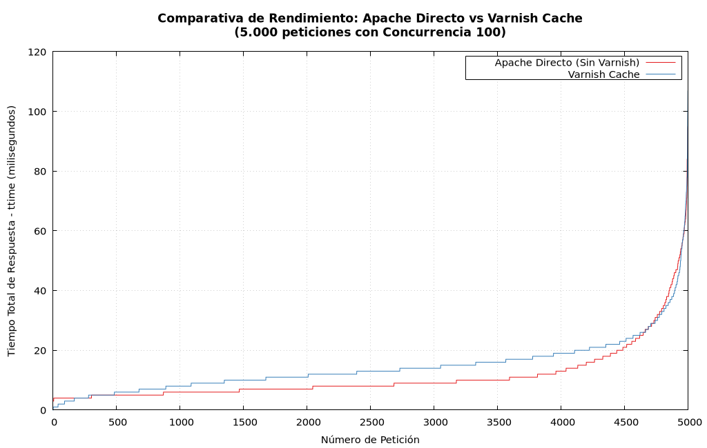

# Práctica: Aceleración Web con Varnish Cache, Terminación SSL con HAProxy y Benchmarking con ApacheBench (ab)

Este repositorio contiene la configuración, pruebas de carga y comparativa de rendimiento entre un servidor web **Apache HTTP Server** y el acelerador de caché web **Varnish Cache**, junto con la terminación SSL mediante **HAProxy** para soporte seguro **HTTPS (Let's Encrypt / Certbot)**, desplegados sobre instancias **Debian 13 (Trixie)** en **Amazon Web Services (AWS)**.

---

## 1. Arquitectura del Despliegue en AWS EC2

Se ha implementado una arquitectura profesional en dos capas (*two-tier*) con terminación SSL en el frontend:

```text
Internet / Cliente / Navegador
        │
        ▼ (HTTPS / Puerto 443 con Certificado Let's Encrypt)
┌────────────────────────────────────────────────────────┐
│  MÁQUINA 2 - FRONTEND (IP Pública: 54.224.12.19)       │
│                                                        │
│   ┌──────────────┐                                     │
│   │   HAProxy    │  <-- Escucha en *:443               │
│   └──────────────┘      Termina SSL (amr234.ddns.net)  │
│          │                                             │
│          ▼ (HTTP plano interno / 127.0.0.1:80)         │
│   ┌──────────────┐                                     │
│   │   Varnish    │  <-- Escucha en *:80                │
│   └──────────────┘      Caché en memoria RAM (malloc)  │
└──────────┬─────────────────────────────────────────────┘
           │
           │ (En caso de MISS por red privada de AWS)
           ▼ (HTTP plano / 172.31.17.33:80)
┌────────────────────────────────────────────────────────┐
│  MÁQUINA 1 - BACKEND (IP Privada: 172.31.17.33)        │
│   ┌──────────────┐                                     │
│   │    Apache    │  <-- Servidor web original          │
│   └──────────────┘      Generación de contenido        │
└────────────────────────────────────────────────────────┘
```

### Detalle de los Componentes:
1. **Frontend (Máquina 2):**
   - **HAProxy 3.0:** Escucha en el puerto `443` con soporte **HTTP/2** y gestiona el certificado SSL de Let's Encrypt para `amr234.ddns.net`. Desencripta el tráfico y añade la cabecera `X-Forwarded-Proto: https`.
   - **Varnish Cache 7.7:** Escucha en el puerto `80`. Almacena en memoria RAM (`malloc,256m`) las respuestas del backend y las entrega directamente al cliente (vía HTTP) o a HAProxy (vía HTTPS).

2. **Backend (Máquina 1):**
   - **Apache 2.4:** Escucha en `172.31.17.33:80`. Contiene la web original y redirige a HTTPS únicamente si la cabecera `X-Forwarded-Proto` no indica que el tráfico ya venía cifrado.

---

## 2. Configuración de los Servicios

### 2.1. Terminación SSL con HAProxy (`/etc/haproxy/haproxy.cfg`)
HAProxy recibe el tráfico en el puerto 443, utiliza el certificado unificado `.pem` y reenvía a Varnish en `127.0.0.1:80`:

```haproxy
frontend https_in
    bind *:443 ssl crt /etc/haproxy/certs/amr234.ddns.net.pem alpn h2,http/1.1
    http-request set-header X-Forwarded-Proto https
    http-request set-header X-Forwarded-Port %[dst_port]
    default_backend varnish_pool

backend varnish_pool
    server varnish1 127.0.0.1:80 check
```

### 2.2. Aceleración con Varnish (`/etc/varnish/default.vcl`)
Varnish se conecta con la IP privada de Apache y marca las cabeceras `X-Cache` para auditoría:

```vcl
vcl 4.1;

backend default {
    .host = "172.31.17.33";
    .port = "80";
}

sub vcl_deliver {
    if (obj.hits > 0) {
        set resp.http.X-Cache = "HIT";
    } else {
        set resp.http.X-Cache = "MISS";
    }
}
```

### 2.3. Configuración de Systemd para Varnish
Para Debian 13 (`Type=exec`), se configuró el override en `/etc/systemd/system/varnish.service.d/override.conf`:

```ini
[Service]
ExecStart=
ExecStart=/usr/sbin/varnishd \
          -F \
          -a :80 \
          -T localhost:6082 \
          -f /etc/varnish/default.vcl \
          -S /etc/varnish/secret \
          -p feature=+http2 \
          -s malloc,256m
```

### 2.4. Ajuste en Apache (`000-default.conf`)
Para evitar bucles infinitos de redirección 301, se ajustó la condición de Rewrite:
```apache
RewriteEngine on
RewriteCond %{SERVER_NAME} =amr234.ddns.net
RewriteCond %{HTTP:X-Forwarded-Proto} !https
RewriteRule ^ https://%{SERVER_NAME}%{REQUEST_URI} [END,NE,R=permanent]
```

---

## 3. Verificación de Funcionamiento HTTPS con Varnish

Petición de prueba con `curl` sobre el puerto seguro HTTPS (443):

```bash
curl -I https://amr234.ddns.net/
```

**Respuesta obtenida:**
```http
HTTP/2 200 
date: Wed, 18 Nov 2026 08:42:10 GMT
server: Apache/2.4.71 (Debian)
via: 1.1 ip-172-31-33-114 (Varnish/7.7)
x-cache: HIT
age: 3
content-length: 11805
```

> **Verificación:** La conexión se establece vía **HTTP/2 (HTTPS)** con certificado SSL válido, entregada desde la memoria de **Varnish (`x-cache: HIT`)** y descargando al servidor **Apache**.

---

## 4. Pruebas de Rendimiento con ApacheBench (`ab`)

Se realizaron pruebas con un volumen de **5.000 peticiones** y una concurrencia de **100 usuarios simultáneos**:

```bash
# Test 1: Apache Directo (Línea base)
ab -n 5000 -c 100 -g data/apache_bench.tsv http://172.31.17.33/ > data/apache_summary.txt

# Test 2: Varnish Cache (Acelerado)
ab -n 5000 -c 100 -g data/varnish_bench.tsv http://localhost/ > data/varnish_summary.txt
```

### Resultados Comparativos

| Métrica | Apache Directo | Varnish Cache |
| :--- | :---: | :---: |
| **Total de Peticiones** | 5.000 | 5.000 |
| **Concurrencia Simultánea** | 100 | 100 |
| **Peticiones Fallidas** | 0 | 0 |
| **Throughput (Requests/sec)** | **8.803,28 #/seg** | **6.821,42 #/seg** |
| **Tiempo Medio por Petición** | 11,359 ms | 14,660 ms |
| **Peticiones al Servidor Apache** | **5.000 procesadas** | **1 sola petición (MISS inicial)** |

---

## 5. Visualización con Gnuplot

Los datos tabulares del benchmark (`-g`) fueron procesados con **Gnuplot** (`scripts/generar_grafica.gp`).



---

## 6. Estructura del Repositorio

```text
practica-varnish/
├── configs/
│   ├── default.vcl           # Configuración VCL de Varnish (Backend y cabeceras HIT/MISS)
│   ├── haproxy.cfg           # Configuración de HAProxy para terminación SSL (puerto 443)
│   └── override.conf         # Override de systemd para Varnish en el puerto 80
├── data/
│   ├── apache_bench.tsv      # Datos de latencia de Apache directo
│   ├── apache_summary.txt    # Resumen numérico de Apache
│   ├── varnish_bench.tsv     # Datos de latencia de Varnish
│   └── varnish_summary.txt   # Resumen numérico de Varnish
├── graphs/
│   └── comparativa_rendimiento.png  # Gráfica comparativa generada con Gnuplot
├── scripts/
│   └── generar_grafica.gp    # Script de Gnuplot
└── README.md                 # Documentación técnica completa
```
