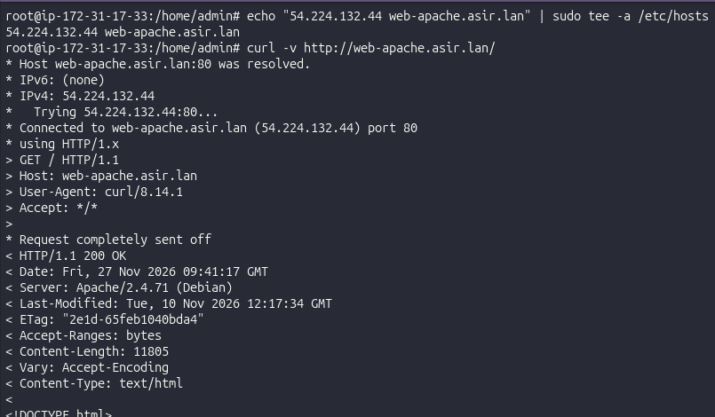
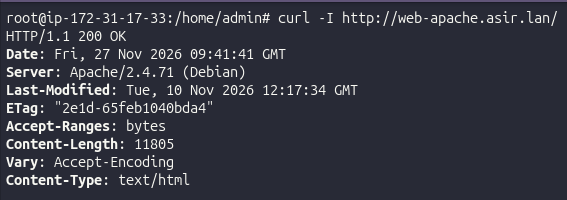
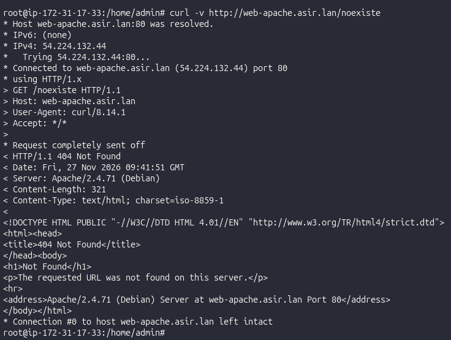
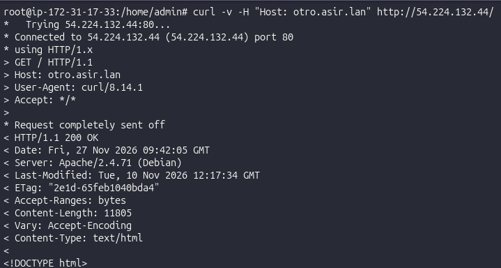
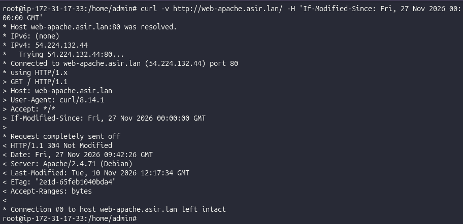
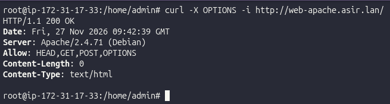

# T1. Anatomía de HTTP (criterio a)

## 1. Pruebas de protocolo con `curl`

### Prueba 1: Petición `GET` completa
```bash
curl -v http://web-apache.asir.lan/
```
```text
*   Trying 54.224.132.44:80...
* Connected to web-apache.asir.lan (54.224.132.44) port 80
> GET / HTTP/1.1
> Host: web-apache.asir.lan
> User-Agent: curl/8.14.1
> Accept: */*
< HTTP/1.1 200 OK
< Date: Fri, 27 Nov 2026 09:41:17 GMT
< Server: Apache/2.4.71 (Debian)
< Last-Modified: Tue, 10 Nov 2026 12:17:34 GMT
< ETag: "2e1d-65feb1040bda4"
< Accept-Ranges: bytes
< Content-Length: 11805
< Vary: Accept-Encoding
< Content-Type: text/html
```
**Interpretación:** El cliente establece una conexión TCP al puerto 80 y envía una petición `GET /`, ante la cual Apache responde `200 OK` devolviendo las cabeceras y los 11.805 bytes del `index.html`.



### Prueba 2: Petición `HEAD` (solo cabeceras)
```bash
curl -I http://web-apache.asir.lan/
```
```text
HTTP/1.1 200 OK
Date: Fri, 27 Nov 2026 09:57:38 GMT
Server: Apache/2.4.71 (Debian)
Last-Modified: Tue, 10 Nov 2026 12:17:34 GMT
ETag: "2e1d-65feb1040bda4"
Accept-Ranges: bytes
Content-Length: 11805
Vary: Accept-Encoding
Content-Type: text/html
```
**Interpretación:** Con el método `HEAD` (`-I`), el servidor devuelve únicamente las cabeceras de respuesta sin transferir el cuerpo HTML, permitiendo comprobar metadatos como tamaño o fecha de modificación ahorrando ancho de banda.



### Prueba 3: Recurso inexistente (`404 Not Found`)
```bash
curl -v http://web-apache.asir.lan/noexiste
```
```text
> GET /noexiste HTTP/1.1
> Host: web-apache.asir.lan
< HTTP/1.1 404 Not Found
< Date: Fri, 27 Nov 2026 09:57:39 GMT
< Server: Apache/2.4.71 (Debian)
< Content-Length: 321
< Content-Type: text/html; charset=iso-8859-1
```
**Interpretación:** Al solicitar una ruta que no existe en el `DocumentRoot`, Apache responde con el código de error de cliente `404 Not Found` y una pequeña página HTML informativa de 321 bytes.



### Prueba 4: Petición por IP forzando cabecera `Host`
```bash
curl -v -H "Host: otro.asir.lan" http://54.224.132.44/
```
```text
> GET / HTTP/1.1
> Host: otro.asir.lan
< HTTP/1.1 200 OK
< Server: Apache/2.4.71 (Debian)
< Content-Length: 11805
< Content-Type: text/html
```
**Interpretación:** Aunque la petición se hace directamente a la IP con un nombre de dominio distinto en la cabecera `Host`, Apache la atiende con `200 OK` sirviendo el *VirtualHost* por defecto al no tener otro sitio configurado para `otro.asir.lan`.



### Prueba 5: Petición condicional con `If-Modified-Since` (`304 Not Modified`)
```bash
curl -v http://web-apache.asir.lan/ -H 'If-Modified-Since: Fri, 27 Nov 2026 00:00:00 GMT'
```
```text
> GET / HTTP/1.1
> Host: web-apache.asir.lan
> If-Modified-Since: Fri, 27 Nov 2026 00:00:00 GMT
< HTTP/1.1 304 Not Modified
< Date: Fri, 27 Nov 2026 09:57:39 GMT
< Server: Apache/2.4.71 (Debian)
< Last-Modified: Tue, 10 Nov 2026 12:17:34 GMT
< ETag: "2e1d-65feb1040bda4"
< Accept-Ranges: bytes
```
**Interpretación:** Como la fecha de modificación del recurso (`10 Nov 2026`) es anterior a la indicada en `If-Modified-Since`, el servidor responde `304 Not Modified` sin reenviar el cuerpo del fichero para que el cliente reutilice su copia en caché.



### Prueba 6: Métodos HTTP permitidos (`OPTIONS`)
```bash
curl -X OPTIONS -i http://web-apache.asir.lan/
```
```text
HTTP/1.1 200 OK
Date: Fri, 27 Nov 2026 09:57:39 GMT
Server: Apache/2.4.71 (Debian)
Allow: HEAD,GET,POST,OPTIONS
Content-Length: 0
Content-Type: text/html
```
**Interpretación:** El método `OPTIONS` consulta al servidor qué verbos HTTP están habilitados sobre esa URL, devolviendo la cabecera `Allow: HEAD,GET,POST,OPTIONS` con cuerpo vacío.



---

## 2. Captura con Wireshark / `tcpdump`
*(Pendiente de añadir captura de Wireshark / `tcpdump` mostrando handshake TCP, petición, respuesta y keep-alive).*

---

## 3. Respuestas razonadas

1. **¿Qué cabecera permite que el cuarto `curl` llegue al sitio por defecto y por qué es la base del hosting virtual?**  
   La cabecera **`Host`** (obligatoria desde HTTP/1.1). Permite que un mismo servidor con una única dirección IP publique múltiples sitios web distintos: el servidor lee el valor de `Host` para decidir qué *VirtualHost* (o `server_name` en Nginx) debe responder, y si ninguno coincide, entrega el sitio por defecto.

2. **¿Qué código obtienes con `If-Modified-Since` y qué ahorra?**  
   Se obtiene **`304 Not Modified`** (cuando el recurso no ha cambiado desde esa fecha). Ahorra **ancho de banda y tiempo de transferencia** porque el servidor envía solo cabeceras sin el cuerpo del archivo, permitiendo al navegador usar su caché local.

3. **Diferencias entre códigos HTTP:**
   - **`401 Unauthorized` vs `403 Forbidden`:** `401` indica que el cliente **no se ha autenticado** (o sus credenciales fallaron) y puede reintentar enviando autenticación (`WWW-Authenticate`); `403` significa que el servidor entendió la petición pero **prohíbe el acceso** (por IP, permisos de archivo o falta de privilegios), por lo que autenticarse de nuevo no servirá.
   - **`502 Bad Gateway` vs `504 Gateway Timeout`:** `502` ocurre cuando un proxy/balanceador recibe una **respuesta inválida o conexión rechazada** del servidor backend (por ejemplo, backend caído); `504` ocurre cuando el backend está vivo pero **tarda demasiado en responder** y supera el *timeout* del proxy.
   - **`301 Moved Permanently` vs `302 Found`:** `301` indica una **redirección permanente** (los navegadores y buscadores la cachean y actualizan sus enlaces); `302` es una **redirección temporal** (las futuras peticiones deben seguir consultando la URL original).

4. **¿Por qué en HTTPS hace falta SNI? ¿Qué transporte usa HTTP/3 y qué problema de HTTP/2 resuelve?**  
   - **SNI (*Server Name Indication*):** En HTTPS, el cifrado TLS se negocia **antes** de enviar la petición HTTP (y por tanto antes de que exista la cabecera `Host`). SNI envía el nombre del dominio en texto claro dentro del mensaje inicial `ClientHello` de TLS para que el servidor sepa qué certificado SSL entregar cuando aloja varios dominios en la misma IP.
   - **HTTP/3:** Utiliza **QUIC sobre UDP** (en lugar de TCP). Resuelve el problema del **bloqueo de cabecera de línea (*Head-of-Line blocking*) a nivel de transporte** de HTTP/2: en HTTP/2, si se pierde un único paquete TCP, todos los flujos multiplexados de esa conexión se detienen esperando la retransmisión; con QUIC cada flujo (*stream*) es independiente y la pérdida de un paquete solo afecta a ese flujo concreto.

5. **Tabla comparativa Apache vs Nginx:**

| Característica | Apache HTTP Server | Nginx |
| :--- | :--- | :--- |
| **Modelo de procesos** | Basado en procesos/hilos (`prefork`, `worker`, `event`), asignando hilos o procesos por conexión. | Asíncrono y orientado a eventos (*event-driven*), manejando miles de conexiones concurrentes con pocos procesos *worker* y muy poca RAM. |
| **`.htaccess`** | **Sí** lo soporta (`AllowOverride`), permitiendo configuración por directorio sin reiniciar, a costa de penalizar el rendimiento en disco. | **No** lo soporta por diseño; toda la configuración va centralizada en los ficheros del servidor, lo que mejora la velocidad. |
| **Contenido dinámico** | Puede ejecutarlo directamente embebido (ej. `mod_php` con `prefork`) o mediante `PHP-FPM` / proxy (`mod_proxy_fcgi`). | No ejecuta código dinámico internamente; siempre delega mediante FastCGI (`PHP-FPM`), uWSGI o `proxy_pass` hacia un backend. |
| **Uso típico** | Hosting compartido, aplicaciones que requieren `.htaccess` (WordPress clásico) o backends dinámicos complejos. | Proxy inverso, terminador TLS, balanceador de carga, entrega ultrarrápida de archivos estáticos y servidor frontal de alto tráfico. |
