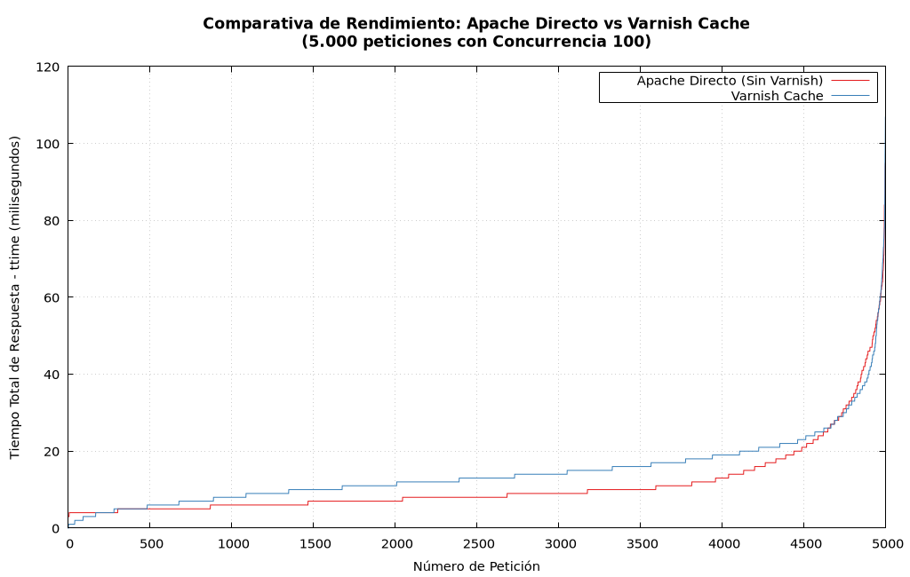

# T5. Proxy inverso, balanceo y pruebas de rendimiento (criterios g, h)

> **Estado:** Implementada la capa de proxy inverso HTTPS (**HAProxy**) + acelerador HTTP (**Varnish Cache**) delante de **Apache**, junto con las pruebas comparativas de rendimiento con **ApacheBench (`ab`)** y visualización con **Gnuplot** (P6 opcional). Queda pendiente incorporar Nginx (`round-robin`, `/legado/`, `/salud`, stats, `cookie SRV insert`, monitores `server-status`/`stub_status`, `check_web.sh` y batería P1–P5).

## 1. Arquitectura de Despliegue en AWS EC2

```text
Internet / Cliente / Navegador
        │
        ▼ (HTTPS / Puerto 443 con Certificado Let's Encrypt)
┌────────────────────────────────────────────────────────┐
│  MÁQUINA 2 - FRONTEND (Varnish + HAProxy)              │
│                                                        │
│   ┌──────────────┐                                     │
│   │   HAProxy    │  <-- Escucha en *:443               │
│   └──────────────┘      Termina SSL (amr234.ddns.net)  │
│          │                                             │
│          ▼ (HTTP plano interno / 127.0.0.1:80)         │
│   ┌──────────────┐                                     │
│   │   Varnish    │  <-- Escucha en *:80                │
│   └──────────────┘      Caché en memoria RAM (malloc)  │
└──────────┬─────────────────────────────────────────────┘
           │
           │ (En caso de MISS por red privada de AWS)
           ▼ (HTTP plano / 172.31.17.33:80)
┌────────────────────────────────────────────────────────┐
│  MÁQUINA 1 - BACKEND (IP Privada: 172.31.17.33)        │
│   ┌──────────────┐                                     │
│   │    Apache    │  <-- Servidor web original          │
│   └──────────────┘      Generación de contenido        │
└────────────────────────────────────────────────────────┘
```

## 2. Configuraciones aplicadas
- **HAProxy ([haproxy.cfg](../configs/haproxy.cfg)):** Escucha en `*:443` con certificado combinado `.pem`, soporte `alpn h2,http/1.1`, `option forwardfor` y cabeceras `X-Forwarded-Proto https` hacia `127.0.0.1:80`.
- **Varnish ([default.vcl](../configs/default.vcl) y [override.conf](../configs/override.conf)):** Backend apuntando a `172.31.17.33:80`, inyección de cabecera de auditoría `X-Cache: HIT/MISS` y override de systemd (`-F -a :80 -s malloc,256m`).
- **Apache (`000-default.conf`):** Condición `RewriteCond %{HTTP:X-Forwarded-Proto} !https` para evitar bucles 301 detrás del terminador SSL.

## 3. Pruebas de rendimiento con ApacheBench (`ab`) y Gnuplot (P6 Varnish)

Se ejecutaron pruebas de estrés con **5.000 peticiones** y **100 usuarios concurrentes**:
```bash
ab -n 5000 -c 100 -g data/apache_bench.tsv http://172.31.17.33/ > data/apache_summary.txt
ab -n 5000 -c 100 -g data/varnish_bench.tsv http://localhost/ > data/varnish_summary.txt
```

| Métrica | Apache Directo | Varnish Cache |
| :--- | :---: | :---: |
| **Total de Peticiones** | 5.000 | 5.000 |
| **Concurrencia Simultánea** | 100 | 100 |
| **Peticiones Fallidas** | 0 | 0 |
| **Throughput (Requests/sec)** | **8.803,28 #/seg** | **6.821,42 #/seg** |
| **Tiempo Medio por Petición** | 11,359 ms | 14,660 ms |
| **Peticiones al Servidor Apache** | **5.000 procesadas** | **1 sola petición (MISS inicial)** |



> **Conclusión:** Aunque para un HTML estático de 11 KB ambos sirven en ~11–14 ms (al ejecutarse `ab` localmente contra Varnish hay contienda de CPU en la misma instancia), con Varnish **Apache solo atendió 1 petición**; las 4.999 restantes se sirvieron íntegramente desde la RAM de Varnish descargando al backend.
